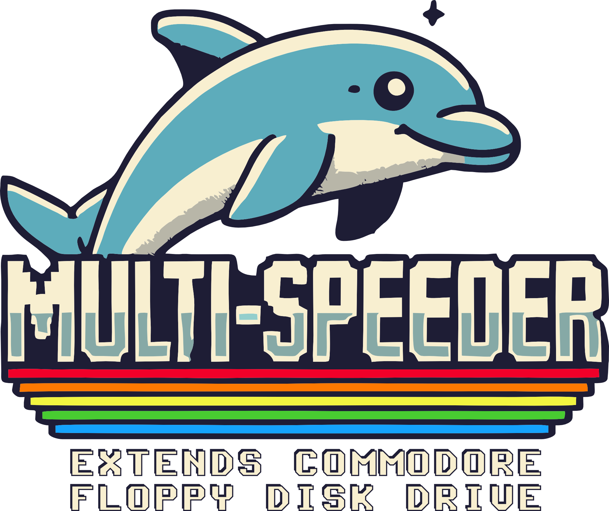
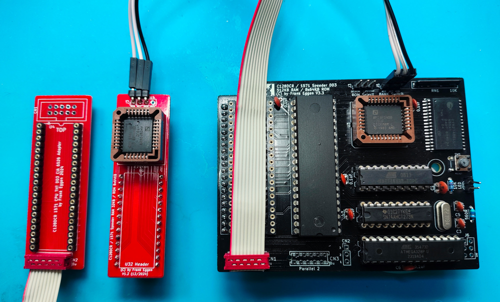
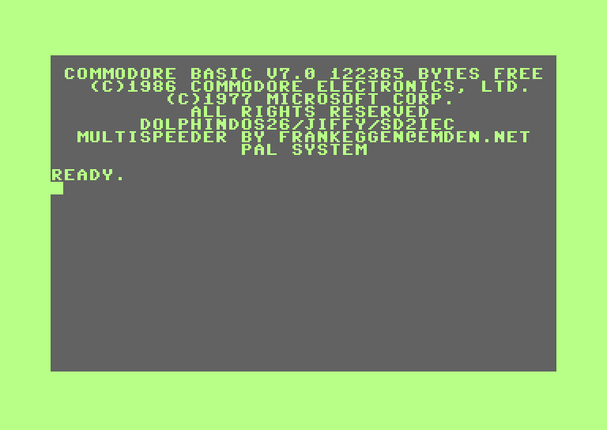
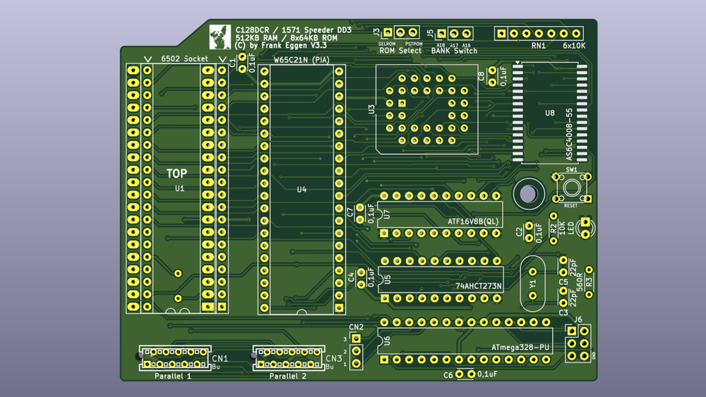
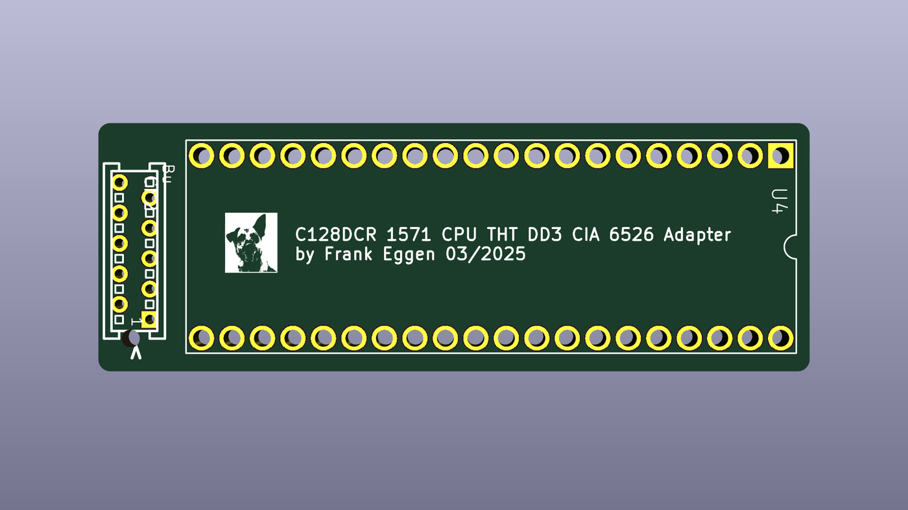
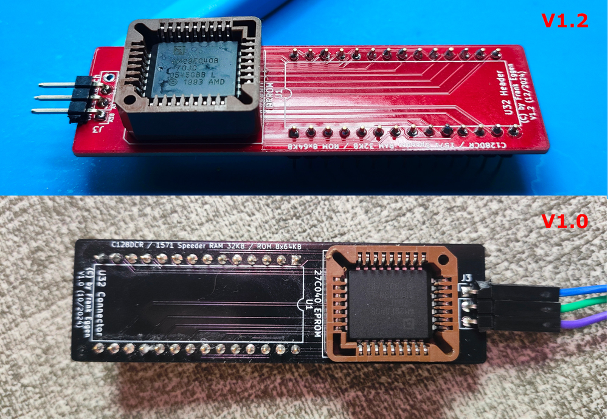
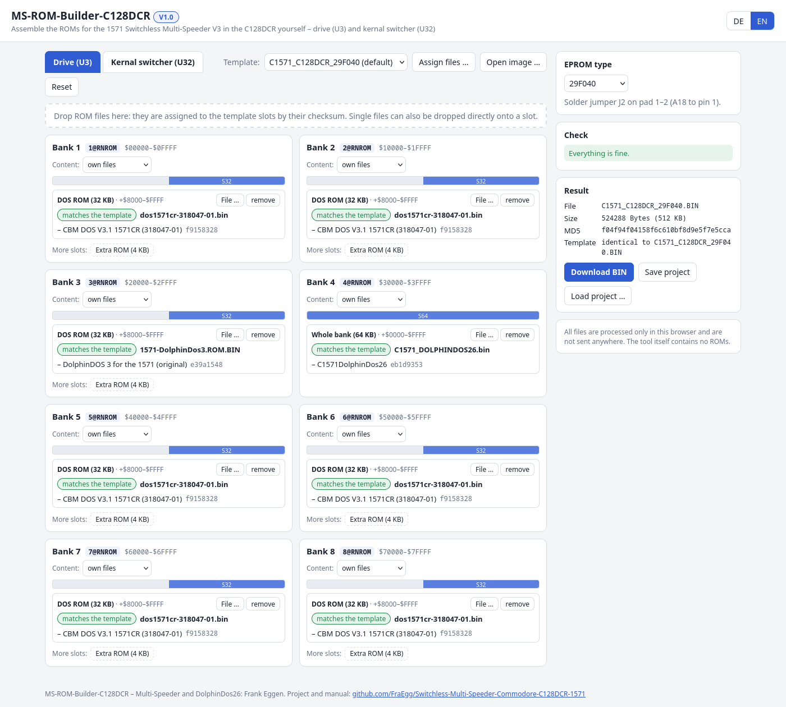
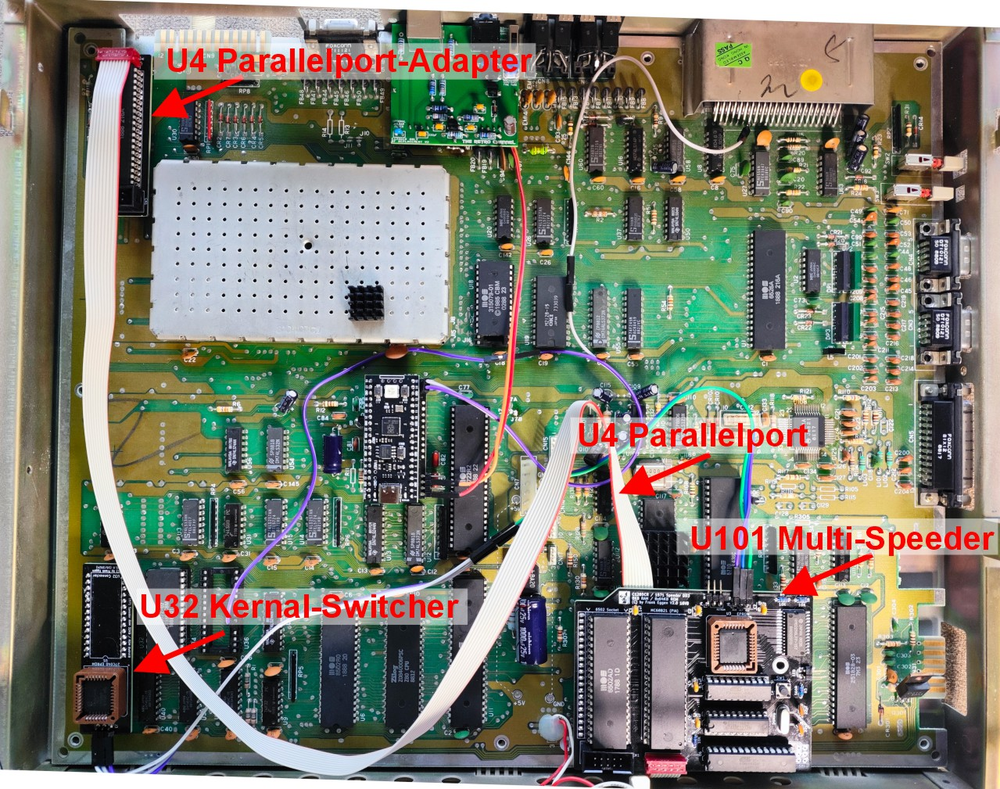

<p align="center"></p>

# Switchless 8x Multi-Floppy-Speeder V3 for the Commodore C128DCR (1571)

**512 KB flash EPROM and 512 KB RAM for the internal 1571 of the C128DCR, with parallel port, kernal switcher and DolphinDos26.**

**Language:** [English](#english) · [Deutsch](#deutsch)

| | English | Deutsch |
|---|---|---|
| MS-ROM-Builder-C128DCR (browser tool for your own EPROM images) | [HTML](rom-builder/MS-ROM-Builder-C128DCR.html) | [HTML](rom-builder/MS-ROM-Builder-C128DCR.html) |
| 1571 Multi-Speeder V3 manual (hardware, build instructions, BOM) | [PDF](manuals/en/MultiSpeederC128DCR-1571_Manual.pdf) | [PDF](manuals/de/MultiSpeederC128DCR-1571_Handbuch.pdf) |
| DolphinDos26 manual (operation, commands, MS-Tools) | [DolphinDOS26](https://github.com/FraEgg/DolphinDOS26) | [DolphinDOS26](https://github.com/FraEgg/DolphinDOS26) |

**Related projects:**

| Project | Repository |
|---|---|
| DolphinDOS26: firmware, C64/C128 kernals, MS-Tools, manuals | [github.com/FraEgg/DolphinDOS26](https://github.com/FraEgg/DolphinDOS26) |
| Switchless 8x Multi-Floppy-Speeder for the 1541 | [github.com/FraEgg/commodore-1541-switchless-floppydrive-8x-multi-floppy-speeder](https://github.com/FraEgg/commodore-1541-switchless-floppydrive-8x-multi-floppy-speeder) |
| Previous release of this C128DCR project (V2.0/V3.3, DolphinDOS 25) | [github.com/FraEgg/commodore-c128dcr-1571-switchless-floppydrive-8x-multi-floppy-speeder](https://github.com/FraEgg/commodore-c128dcr-1571-switchless-floppydrive-8x-multi-floppy-speeder) |
| Order the boards / Platinen bestellen | [Switchless 8x Multi-Floppy-Speeder for the C128DCR at PCBWay](https://www.pcbway.com/project/shareproject/Switchless_8x_Multi_Floppy_Speeder_with_32_KB_RAM_Expansion_for_the_Commodore_C1_557a83c8.html) |

<p align="center"></p>

---

# English

## What is this?

The **1571 Switchless 8x Multi-Floppy-Speeder V3** speeds up the built-in 1571 drive of the **Commodore C128DCR**. It consists of three boards that all disappear inside the case; the user port stays free:

| Board | Sits in the C128DCR | Task |
|---|---|---|
| **Multi-Speeder board** | socket of the 1571 CPU (U101), the 6502 sits on top | DOS EPROM with 8 banks, 512 KB RAM, PIA, microcontroller, address decoder |
| **Parallel port adapter** | socket of CIA 2 (U4), the CIA sits on top | takes port B of the CIA to the Multi-Speeder over a 10-way cable |
| **Kernal switcher** | socket of the kernal ROM (U32) | EPROM with 8 banks for C128 and C64 mode, switched together with the drive |

- **8 DOS banks** of 64 KB in a 512 KB flash EPROM **29F040**, switched by DOS command without a switch (`@I:n@RNROM`)
- **8 kernal banks** for C128 and C64 mode, always switched together with the DOS bank
- **512 KB RAM** in the drive, mapped as 64 banks of 8 KB at `$6000`–`$7FFF`
- a **PIA 6821/W65C21** as an 8-bit parallel port and for selecting the RAM banks
- RAMBoard-compatible for nibbler programs

With **DolphinDos26** for the 1571 and the **C128 kernal DolphinDos26**, the C128DCR gets parallel transfer, track cache, whole disks in the drive RAM (`CDR`/`CDW`), a RAM disk (`CDM`), the MS-Addon-API and the MS-Tools – plus double-sided disks (`CDRD`/`CDWD`/`CDMD`).

<p align="center"></p>

## Which files do I need?

| File | Goes into | Content |
|---|---|---|
| [`C1571_DOLPHINDOS26.bin`](rom/C1571_DOLPHINDOS26.bin) | EPROM U3 of the Multi-Speeder board, bank 4 (offset `$30000`) | DolphinDos26 for the 1571 (64 KB) |
| [`C128DolphinDos26-US.BIN`](rom/C128DolphinDos26-US.BIN) | EPROM of the kernal switcher, bank 4 at `$3C000` | C128 kernal DolphinDos26 (16 KB, C128 mode), international and USA |
| [`C128DolphinDos26-DE.BIN`](rom/C128DolphinDos26-DE.BIN) | EPROM of the kernal switcher, bank 4 at `$3C000` | C128 kernal DolphinDos26 (16 KB, C128 mode) with the German DIN keyboard driver: the CAPS LOCK key is the ASCII/DIN key |
| [`C64IIDolphinDos26.bin`](rom/C64IIDolphinDos26.bin) | EPROM of the kernal switcher, bank 4 at `$38000` | C64 BASIC and kernal DolphinDos26 (16 KB, C64 mode) |
| [`C128DCR_KERNAL_29F040-DE.BIN`](rom/C128DCR_KERNAL_29F040-DE.BIN) | EPROM of the kernal switcher U32 (29F040, 512 KB) | template, German: banks 1–2 and 5–8 Commodore C64 BASIC/kernal and German C128 kernal 315078-03, bank 3 original Dolphin kernals, bank 4 `C64IIDolphinDos26.bin` and `C128DolphinDos26-DE.BIN` |
| [`C128DCR_KERNAL_29F040-US.BIN`](rom/C128DCR_KERNAL_29F040-US.BIN) | EPROM of the kernal switcher U32 (29F040, 512 KB) | template, international/USA: as above with the C128 kernal 318020-05 and, in bank 4, `C128DolphinDos26-US.BIN` |
| [`C1571_C128DCR_29F040.BIN`](rom/C1571_C128DCR_29F040.BIN) | EPROM U3 of the Multi-Speeder board (29F040, 512 KB) | template: original Commodore DOS 318047-01 (1571CR) in banks 1–2 and 5–8, original DolphinDOS 3 for the 1571 in bank 3, DolphinDos26 in bank 4 |
| [`ms-tools.d64`](ms-tools/ms-tools.d64) | disk | MS-Tools for testing (`MS-MEMTEST`) and copying, in C64 mode |
| [`hardware/gal`](hardware/gal) | GAL ATF16V8B (U7) | address decoder `ATF16V8_PAL_Adressendecoder_V3_0PIA_1571.jed` |
| [`hardware/atmega328p`](hardware/atmega328p) | ATmega328P (U6) | ROM switcher firmware (`.hex`), source (`.ino`), XGecu project (`.mpj`) |

The DolphinDos26 ROMs are the same as in the [DolphinDOS26](https://github.com/FraEgg/DolphinDOS26) release. `C1571_C128DCR_29F040.BIN` is a ready-made template for the EPROM of the Multi-Speeder board: in banks 1–2 and 5–8 the 32 KB Commodore DOS and in bank 3 the 32 KB DolphinDOS 3 sit in the upper half (bank start + `$8000`), the lower half is `$FF`; only bank 4 holds the complete 64 KB of DolphinDos26. Program it as it is, or replace single banks with other DOS versions. For the kernal switcher, `C128DCR_KERNAL_29F040-DE.BIN` (German) and `C128DCR_KERNAL_29F040-US.BIN` (international, USA) are ready-made templates whose banks match the drive template: only the upper half of each bank is used (`$x8000` C64 BASIC, `$xA000` C64 kernal, `$xC000` C128 kernal), the lower half is `$FF`. How to assemble the EPROM images is described in chapter 7.6 of the manual.

## Hardware

| Folder | Content |
|---|---|
| [`hardware/gerber`](hardware/gerber) | Gerber files V3.3 for all three boards (two layers) |
| [`hardware/schematics`](hardware/schematics) | Schematics V3.3 as PDF |
| [`hardware/bom`](hardware/bom) | KiCad bills of materials V3.3 (CSV, HTML, XLS) |
| [`hardware/gal`](hardware/gal) | JED file, equations and diagram of the address decoder |
| [`hardware/atmega328p`](hardware/atmega328p) | Firmware of the microcontroller |

The complete bill of materials with DigiKey and Mouser links, the assembly order, fuse bytes (L `0xFF`, H `0xDE`, E `0xFD`, lock `0xCF`) and the installation in the C128DCR are in the [manual](manuals/en/MultiSpeederC128DCR-1571_Manual.pdf), chapters 7 and 8.

**Ordering the boards:** The boards can be made by any common PCB manufacturer from the Gerber files, or ordered directly via my project at PCBWay: [Switchless 8x Multi-Floppy-Speeder for the C128DCR at PCBWay](https://www.pcbway.com/project/shareproject/Switchless_8x_Multi_Floppy_Speeder_with_32_KB_RAM_Expansion_for_the_Commodore_C1_557a83c8.html).

<p align="center">



</p>

## MS-ROM-Builder-C128DCR (build your own EPROM images)

[`rom-builder/MS-ROM-Builder-C128DCR.html`](rom-builder/MS-ROM-Builder-C128DCR.html) is a browser tool for assembling both 512 KB EPROM images yourself: the drive EPROM U3 and the kernal switcher U32. Download the file and open it in a current browser – no installation, works offline on Windows, macOS and Linux, and the ROM files never leave your computer. The tool contains no ROMs.

- Both EPROMs with their eight banks and the slots for 4, 8, 16, 32 and 64 KB; our templates `C1571_C128DCR_29F040.BIN` and `C128DCR_KERNAL_29F040-DE/-US.BIN` are preset.
- Drop your ROM files in: they are assigned by their checksum, or placed directly onto a slot. Finished images can be opened, split into their parts and single banks replaced.
- Checks for missing, different or unknown ROMs, JiffyDOS content, reset vectors and matching drive/kernal banks; shows solder jumper J2 for 29F040, SST39SF040 or 27C040.
- Download the finished 512 KB file with its MD5; save and load the layout as a small project file (no ROM data). German and English.

<p align="center"></p>

## Installation in short

1. Program the **29F040** for the Multi-Speeder board with the template `C1571_C128DCR_29F040.BIN` (Commodore DOS, DolphinDOS 3 in bank 3, DolphinDos26 in bank 4) or with your own image (alternatives: 27C040 or SST39SF040). Set solder jumper **J2** for the EPROM type: 29F040/SST39SF040 pad 1–2, 27C040 pad 2–3.
2. Program the **29F040** of the kernal switcher with the template `C128DCR_KERNAL_29F040-DE.BIN` or `C128DCR_KERNAL_29F040-US.BIN`, or with your own image: `C64IIDolphinDos26.bin` at `$38000` and `C128DolphinDos26-US.BIN` (international, USA) or `C128DolphinDos26-DE.BIN` (German keyboard) at `$3C000` (bank 4); J2 as above.
3. Program GAL and ATmega (do not program the ATmega EEPROM).
4. Socket U101 and U4, **remove the DOS ROM U102**, fit the three boards, connect the parallel cable and J5 → J3.
5. Switch with `OPEN 1,8,15,"I:4@RNROM":CLOSE 1`, reset the C128. `@` reports `73,DOLPHINDOS26 1571,00,00`, loading shows `LOADING DD:`.
6. Test the RAM in C64 mode with `MS-MEMTEST` from the MS-Tools disk.

<p align="center"></p>

## Known limits

- C1571DolphinDos26 always runs at 2 MHz like the original DolphinDOS 3. Before programs with their own fast loader enter `@X-` (1 MHz), or switch to the Commodore ROM with `@I:1@RNROM`.
- At 2 MHz the microcontroller can miss a switching command; repeat it. A 22.1184 MHz crystal and a 74AHCT273 as U5 make switching reliable.
- DolphinDos26 needs the original NMOS 6502, not a WDC 65C02.
- MS-NIBCOPY is written for the 1541, not for the 1571. MS-15SECCOPY itself sets a 1571 with DolphinDOS to 1 MHz with `X-` for BACKUP and VERIFY and back to 2 MHz with `X+` afterwards.

## What is in this repository?

```
manuals/en, de   1571 Multi-Speeder V3 manual as PDF
rom/             DolphinDos26 ROMs for the 1571 and the C128 (C128 and C64 mode),
                 EPROM templates C1571_C128DCR_29F040.BIN (drive),
                 C128DCR_KERNAL_29F040-DE.BIN and -US.BIN (kernal switcher)
ms-tools/        ms-tools.d64
hardware/        Gerber, schematics, BOM, GAL and ATmega files (V3.3)
assets/          Images for this page
rom-builder/     MS-ROM-Builder-C128DCR: browser tool for your own EPROM images
tools/           Maintenance script for this repository
CHECKSUMS.*      MD5 and SHA-256 of all published files
```

Apart from the templates `C1571_C128DCR_29F040.BIN` (Commodore DOS 1571CR, DolphinDOS 3 and DolphinDos26) and `C128DCR_KERNAL_29F040-DE.BIN`/`C128DCR_KERNAL_29F040-US.BIN` (Commodore and original Dolphin kernals, DolphinDos26 kernals), no EPROM image is included. JiffyDOS is commercial software and not part of this project; a licence is available from [RETRO Innovations](https://www.jiffydos.com). The C128 and C64 kernals contain JiffyDOS transfer routines – see [JiffyDOS licence: please check](#jiffydos-licence-please-check).

Verify your download with `sha256sum -c CHECKSUMS.sha256` or `md5sum -c CHECKSUMS.md5`.

## JiffyDOS licence: please check

The C128 kernals [`C128DolphinDos26-US.BIN`](rom/C128DolphinDos26-US.BIN) and [`C128DolphinDos26-DE.BIN`](rom/C128DolphinDos26-DE.BIN) and the C64 mode kernal [`C64IIDolphinDos26.bin`](rom/C64IIDolphinDos26.bin) contain JiffyDOS transfer routines that are instruction-identical to a JiffyDOS kernal (C128: JiffyDOS C128 kernal, C64: JiffyDOS sd2iec kernal). The same applies to bank 4 of the kernal switcher templates `C128DCR_KERNAL_29F040-DE.BIN` and `-US.BIN`, which holds these kernals; all other banks contain no JiffyDOS code. The JiffyDOS drive firmware is not included. Jim Brain of RETRO Innovations, which holds the JiffyDOS licence rights, confirmed that publishing the DolphinDos26 kernals on GitHub is fine. As he describes it, code that implements the same transfer behaviour without being an exact copy needs no licence. If the transfer code is the same, as it is here, he believes the end user would need one.

**Please check for yourself whether your use calls for an official JiffyDOS licence:** <https://www.jiffydos.com>

Details: [DolphinDOS26 – JiffyDOS licence](https://github.com/FraEgg/DolphinDOS26#jiffydos-licence-please-check), technical notes on the [C128 kernal](https://github.com/FraEgg/DolphinDOS26/blob/main/docs/en/c128-kernal.md).

## Credits

| Who | What |
|---|---|
| Günther Jilg, Jan Bubela (Dolphin Software) | DolphinDOS 3.0, the base of DolphinDos26 |
| Per Bengtsson (RetroNynjah) | [Switchless Multi-ROM](https://github.com/RetroNynjah/Switchless-Multi-ROM-for-27128-27256), the ROM switcher sketch |
| Jim Drew, Joeri van Haren | Help and review of the hardware (V2.1) |
| silverdr | [Technical documentation on DolphinDOS 3](https://e4aws.silverdr.com/projects/dolphindos3/) |
| ytmytm | [1571 TrackCache ROM patch](https://github.com/ytmytm/1571-TrackCacheROM) |
| Stefan Kauf | Support with the idea of the Multi-Speeder |
| Mark Fellows / Creative Micro Designs; Jim Brain, RETRO Innovations | JiffyDOS |

**Special thanks to Jim Brain of RETRO Innovations** for his support with the JiffyDOS implementation of the DolphinDos26 kernals.

Multi-Speeder, DolphinDos26 and the manuals: **Frank Eggen**. If you would like to support the project: [donation via PayPal](https://www.paypal.com/donate/?cmd=_s-xclick&hosted_button_id=Q8HXKYARXKT4L&ssrt=1714757590172).

## Licence

Free for private, non-commercial use. No sale and no commercial use (boards, kits, ROM files, programmed EPROMs) without consulting the developer. Private hobby project without any warranty; building and installation at your own risk. Details: [LICENSE.md](LICENSE.md).

---

# Deutsch

## Was ist das?

Der **1571 Switchless 8x Multi-Floppy-Speeder V3** beschleunigt die eingebaute 1571 des **Commodore C128DCR**. Er besteht aus drei Platinen, die alle im Gehäuse verschwinden; der Userport bleibt frei:

| Platine | Sitzt im C128DCR | Aufgabe |
|---|---|---|
| **Multi-Speeder-Platine** | Sockel der 1571-CPU (U101), die 6502 sitzt obenauf | DOS-EPROM mit 8 Bänken, 512 KB RAM, PIA, Mikrocontroller, Adressdecoder |
| **Parallelport-Adapter** | Sockel der CIA 2 (U4), die CIA sitzt obenauf | führt Port B der CIA über ein 10-poliges Kabel zum Multi-Speeder |
| **Kernal-Switcher** | Sockel des Kernal-ROMs (U32) | EPROM mit 8 Bänken für C128- und C64-Modus, wird mit dem Laufwerk umgeschaltet |

- **8 DOS-Bänke** zu 64 KB in einem 512-KB-Flash-EPROM **29F040**, umschaltbar per DOS-Befehl ohne Schalter (`@I:n@RNROM`)
- **8 Kernal-Bänke** für C128- und C64-Modus, immer zusammen mit der DOS-Bank umgeschaltet
- **512 KB RAM** im Laufwerk, als 64 Bänke zu 8 KB bei `$6000`–`$7FFF` eingeblendet
- eine **PIA 6821/W65C21** als 8-Bit-Parallelport und zur Auswahl der RAM-Bänke
- RAMBoard-kompatibel für Nibbler-Programme

Mit **DolphinDos26** für die 1571 und dem **C128-Kernal DolphinDos26** bekommt der C128DCR Parallelübertragung, Track-Cache, ganze Disketten im Laufwerks-RAM (`CDR`/`CDW`), eine RAM-Disk (`CDM`), die MS-Addon-API und die MS-Tools – und dazu doppelseitige Disketten (`CDRD`/`CDWD`/`CDMD`).

## Welche Dateien brauche ich?

| Datei | Gehört in | Inhalt |
|---|---|---|
| [`C1571_DOLPHINDOS26.bin`](rom/C1571_DOLPHINDOS26.bin) | EPROM U3 der Multi-Speeder-Platine, Bank 4 (Offset `$30000`) | DolphinDos26 für die 1571 (64 KB) |
| [`C128DolphinDos26-US.BIN`](rom/C128DolphinDos26-US.BIN) | EPROM des Kernal-Switchers, Bank 4 bei `$3C000` | C128-Kernal DolphinDos26 (16 KB, C128-Modus), international und USA |
| [`C128DolphinDos26-DE.BIN`](rom/C128DolphinDos26-DE.BIN) | EPROM des Kernal-Switchers, Bank 4 bei `$3C000` | C128-Kernal DolphinDos26 (16 KB, C128-Modus) mit deutschem DIN-Tastaturtreiber: die CAPS-LOCK-Taste ist die ASCII/DIN-Taste |
| [`C64IIDolphinDos26.bin`](rom/C64IIDolphinDos26.bin) | EPROM des Kernal-Switchers, Bank 4 bei `$38000` | C64-BASIC und -Kernal DolphinDos26 (16 KB, C64-Modus) |
| [`C128DCR_KERNAL_29F040-DE.BIN`](rom/C128DCR_KERNAL_29F040-DE.BIN) | EPROM des Kernal-Switchers U32 (29F040, 512 KB) | Vorlage deutsch: Bänke 1–2 und 5–8 Commodore-C64-BASIC/-Kernal und deutscher C128-Kernal 315078-03, Bank 3 originale Dolphin-Kernals, Bank 4 `C64IIDolphinDos26.bin` und `C128DolphinDos26-DE.BIN` |
| [`C128DCR_KERNAL_29F040-US.BIN`](rom/C128DCR_KERNAL_29F040-US.BIN) | EPROM des Kernal-Switchers U32 (29F040, 512 KB) | Vorlage international/USA: wie oben mit dem C128-Kernal 318020-05 und in Bank 4 `C128DolphinDos26-US.BIN` |
| [`C1571_C128DCR_29F040.BIN`](rom/C1571_C128DCR_29F040.BIN) | EPROM U3 der Multi-Speeder-Platine (29F040, 512 KB) | Vorlage: originales Commodore-DOS 318047-01 (1571CR) in den Bänken 1–2 und 5–8, originales DolphinDOS 3 für die 1571 in Bank 3, DolphinDos26 in Bank 4 |
| [`ms-tools.d64`](ms-tools/ms-tools.d64) | Diskette | MS-Tools zum Testen (`MS-MEMTEST`) und Kopieren, im C64-Modus |
| [`hardware/gal`](hardware/gal) | GAL ATF16V8B (U7) | Adressdecoder `ATF16V8_PAL_Adressendecoder_V3_0PIA_1571.jed` |
| [`hardware/atmega328p`](hardware/atmega328p) | ATmega328P (U6) | Firmware des ROM-Umschalters (`.hex`), Quelle (`.ino`), XGecu-Projekt (`.mpj`) |

Die DolphinDos26-ROMs sind dieselben wie im Release von [DolphinDOS26](https://github.com/FraEgg/DolphinDOS26). `C1571_C128DCR_29F040.BIN` ist eine fertige Vorlage für das EPROM der Multi-Speeder-Platine: In den Bänken 1–2 und 5–8 liegt das 32-KB-Commodore-DOS, in Bank 3 das 32-KB-DolphinDOS 3 in der oberen Hälfte (Bankanfang + `$8000`), die untere Hälfte ist `$FF`; nur Bank 4 enthält die vollen 64 KB von DolphinDos26. Sie kann so gebrannt werden, oder einzelne Bänke werden durch andere DOS-Versionen ersetzt. Für den Kernal-Switcher sind `C128DCR_KERNAL_29F040-DE.BIN` (deutsch) und `C128DCR_KERNAL_29F040-US.BIN` (international, USA) fertige Vorlagen, deren Bänke zur Laufwerks-Vorlage passen: Je Bank wird nur die obere Hälfte genutzt (`$x8000` C64-BASIC, `$xA000` C64-Kernal, `$xC000` C128-Kernal), die untere Hälfte ist `$FF`. Wie die EPROM-Abbilder zusammengesetzt werden, steht im Handbuch in Kapitel 7.6.

## Hardware

| Ordner | Inhalt |
|---|---|
| [`hardware/gerber`](hardware/gerber) | Gerber-Dateien V3.3 für alle drei Platinen (zweilagig) |
| [`hardware/schematics`](hardware/schematics) | Schaltpläne V3.3 als PDF |
| [`hardware/bom`](hardware/bom) | KiCad-Stücklisten V3.3 (CSV, HTML, XLS) |
| [`hardware/gal`](hardware/gal) | JED-Datei, Gleichungen und Diagramm des Adressdecoders |
| [`hardware/atmega328p`](hardware/atmega328p) | Firmware des Mikrocontrollers |

Die vollständige Stückliste mit DigiKey- und Mouser-Links, die Bestückungsreihenfolge, die Fuse-Bytes (L `0xFF`, H `0xDE`, E `0xFD`, Lock `0xCF`) und der Einbau in den C128DCR stehen im [Handbuch](manuals/de/MultiSpeederC128DCR-1571_Handbuch.pdf), Kapitel 7 und 8.

**Platinen bestellen:** Die Platinen fertigt jeder übliche Leiterplattenhersteller aus den Gerber-Dateien, oder sie werden direkt über mein Projekt bei PCBWay bestellt: [Switchless 8x Multi-Floppy-Speeder für den C128DCR bei PCBWay](https://www.pcbway.com/project/shareproject/Switchless_8x_Multi_Floppy_Speeder_with_32_KB_RAM_Expansion_for_the_Commodore_C1_557a83c8.html).

## MS-ROM-Builder-C128DCR (EPROM-Abbilder selbst bauen)

[`rom-builder/MS-ROM-Builder-C128DCR.html`](rom-builder/MS-ROM-Builder-C128DCR.html) ist ein Browser-Tool, mit dem sich beide 512-KB-EPROM-Abbilder selbst zusammenstellen lassen: das Laufwerks-EPROM U3 und der Kernal-Switcher U32. Die Datei herunterladen und in einem aktuellen Browser öffnen – ohne Installation, offline unter Windows, macOS und Linux, und die ROM-Dateien verlassen den Rechner nicht. Das Tool enthält keine ROMs.

- Beide EPROMs mit ihren acht Bänken und den Steckplätzen für 4, 8, 16, 32 und 64 KB; unsere Vorlagen `C1571_C128DCR_29F040.BIN` und `C128DCR_KERNAL_29F040-DE/-US.BIN` sind voreingestellt.
- ROM-Dateien hineinziehen: Sie werden über ihre Prüfsumme zugeordnet oder direkt auf einen Steckplatz gelegt. Fertige Abbilder lassen sich öffnen, in ihre Teile zerlegen und einzelne Bänke tauschen.
- Prüfung auf fehlende, abweichende oder unbekannte ROMs, JiffyDOS-Inhalt, Reset-Vektoren und zueinander passende Laufwerks- und Kernal-Bänke; zeigt die Lötbrücke J2 für 29F040, SST39SF040 oder 27C040.
- Die fertige 512-KB-Datei mit MD5 herunterladen; die Belegung als kleine Projektdatei speichern und laden (ohne ROM-Daten). Deutsch und Englisch.

<p align="center"></p>

## Einbau in Kürze

1. Den **29F040** für die Multi-Speeder-Platine mit der Vorlage `C1571_C128DCR_29F040.BIN` (Commodore-DOS, DolphinDOS 3 in Bank 3, DolphinDos26 in Bank 4) oder einem eigenen Abbild brennen (Alternativen: 27C040 oder SST39SF040). Die Lötbrücke **J2** passend zum EPROM-Typ setzen: 29F040/SST39SF040 Pad 1–2, 27C040 Pad 2–3.
2. Den **29F040** des Kernal-Switchers mit der Vorlage `C128DCR_KERNAL_29F040-DE.BIN` oder `C128DCR_KERNAL_29F040-US.BIN` brennen, oder mit einem eigenen Abbild: `C64IIDolphinDos26.bin` bei `$38000` und `C128DolphinDos26-US.BIN` (international, USA) oder `C128DolphinDos26-DE.BIN` (deutsche Tastatur) bei `$3C000` (Bank 4) brennen; J2 wie oben.
3. GAL und ATmega programmieren (das EEPROM des ATmega nicht mitprogrammieren).
4. U101 und U4 sockeln, **das DOS-ROM U102 entfernen**, die drei Platinen einsetzen, Parallelkabel und J5 → J3 verbinden.
5. Mit `OPEN 1,8,15,"I:4@RNROM":CLOSE 1` umschalten, den C128 per Reset neu starten. `@` meldet `73,DOLPHINDOS26 1571,00,00`, beim Laden erscheint `LOADING DD:`.
6. Im C64-Modus das RAM mit `MS-MEMTEST` von der MS-Tools-Diskette testen.

## Bekannte Grenzen

- C1571DolphinDos26 läuft wie das Original-DolphinDOS 3 immer mit 2 MHz. Vor Programmen mit eigenem Schnelllader `@X-` (1 MHz) eingeben oder mit `@I:1@RNROM` auf das Commodore-ROM wechseln.
- Bei 2 MHz kann der Mikrocontroller einen Umschaltbefehl verpassen; dann den Befehl wiederholen. Ein Quarz mit 22,1184 MHz und ein 74AHCT273 als U5 machen das Umschalten zuverlässig.
- DolphinDos26 braucht die originale NMOS-6502, keine WDC 65C02.
- MS-NIBCOPY ist für die 1541 geschrieben, nicht für die 1571. MS-15SECCOPY stellt eine 1571 mit DolphinDOS für BACKUP und VERIFY selbst mit `X-` auf 1 MHz und danach mit `X+` wieder auf 2 MHz.

## Was liegt in diesem Repository?

```
manuals/en, de   Handbuch 1571 Multi-Speeder V3 als PDF
rom/             DolphinDos26-ROMs für die 1571 und den C128 (C128- und C64-Modus),
                 EPROM-Vorlagen C1571_C128DCR_29F040.BIN (Laufwerk),
                 C128DCR_KERNAL_29F040-DE.BIN und -US.BIN (Kernal-Switcher)
ms-tools/        ms-tools.d64
hardware/        Gerber, Schaltpläne, Stückliste, GAL- und ATmega-Dateien (V3.3)
assets/          Bilder für diese Seite
rom-builder/     MS-ROM-Builder-C128DCR: Browser-Tool für eigene EPROM-Abbilder
tools/           Pflegeskript für dieses Repository
CHECKSUMS.*      MD5 und SHA-256 aller veröffentlichten Dateien
```

Außer den Vorlagen `C1571_C128DCR_29F040.BIN` (Commodore-DOS 1571CR, DolphinDOS 3 und DolphinDos26) und `C128DCR_KERNAL_29F040-DE.BIN`/`C128DCR_KERNAL_29F040-US.BIN` (Commodore- und originale Dolphin-Kernals, DolphinDos26-Kernals) ist kein EPROM-Abbild enthalten. JiffyDOS ist kommerzielle Software und nicht Teil des Projekts; eine Lizenz gibt es bei [RETRO Innovations](https://www.jiffydos.com). Der C128- und der C64-Kernal enthalten JiffyDOS-Übertragungsroutinen – siehe [JiffyDOS-Lizenz: bitte prüfen](#jiffydos-lizenz-bitte-pr%C3%BCfen).

Den Download prüfen mit `sha256sum -c CHECKSUMS.sha256` oder `md5sum -c CHECKSUMS.md5`.

## JiffyDOS-Lizenz: bitte prüfen

Die C128-Kernals [`C128DolphinDos26-US.BIN`](rom/C128DolphinDos26-US.BIN) und [`C128DolphinDos26-DE.BIN`](rom/C128DolphinDos26-DE.BIN) sowie der Kernal für den C64-Modus [`C64IIDolphinDos26.bin`](rom/C64IIDolphinDos26.bin) enthalten JiffyDOS-Übertragungsroutinen, die befehlsgleich aus einem JiffyDOS-Kernal stammen (C128: JiffyDOS-C128-Kernal, C64: JiffyDOS-sd2iec-Kernal). Das gilt auch für Bank 4 der Kernal-Switcher-Vorlagen `C128DCR_KERNAL_29F040-DE.BIN` und `-US.BIN`, in der diese Kernals liegen; alle anderen Bänke enthalten keinen JiffyDOS-Code. Die JiffyDOS-Firmware für das Laufwerk ist nicht enthalten. Jim Brain von RETRO Innovations, das die JiffyDOS-Lizenzrechte hält, hat die Veröffentlichung der DolphinDos26-Kernals auf GitHub erlaubt. Nach seiner Beschreibung ist für Code, der dasselbe Übertragungsverhalten umsetzt, aber keine genaue Kopie ist, keine Lizenz nötig. Ist der Übertragungscode gleich, wie hier, wäre nach seiner Einschätzung beim Endnutzer eine Lizenz erforderlich.

**Bitte prüfe selbst, ob du wegen der Nutzung eine offizielle JiffyDOS-Lizenz erwerben solltest:** <https://www.jiffydos.com>

Einzelheiten: [DolphinDOS26 – JiffyDOS-Lizenz](https://github.com/FraEgg/DolphinDOS26#jiffydos-lizenz-bitte-pr%C3%BCfen), technische Notizen zum [C128-Kernal](https://github.com/FraEgg/DolphinDOS26/blob/main/docs/de/c128-kernal.md).

## Danksagung

| Wer | Was |
|---|---|
| Günther Jilg, Jan Bubela (Dolphin Software) | DolphinDOS 3.0, die Grundlage von DolphinDos26 |
| Per Bengtsson (RetroNynjah) | [Switchless Multi-ROM](https://github.com/RetroNynjah/Switchless-Multi-ROM-for-27128-27256), der Sketch des ROM-Umschalters |
| Jim Drew, Joeri van Haren | Hilfe und Review der Hardware (V2.1) |
| silverdr | [Technische Dokumentation zu DolphinDOS 3](https://e4aws.silverdr.com/projects/dolphindos3/) |
| ytmytm | [1571 TrackCache ROM-Patch](https://github.com/ytmytm/1571-TrackCacheROM) |
| Stefan Kauf | Unterstützung bei der Idee des Multi-Speeders |
| Mark Fellows / Creative Micro Designs; Jim Brain, RETRO Innovations | JiffyDOS |

**Besonderer Dank gilt Jim Brain von RETRO Innovations** für seine Unterstützung bei der JiffyDOS-Implementierung der DolphinDos26-Kernals.

Multi-Speeder, DolphinDos26 und die Handbücher: **Frank Eggen**. Wer das Projekt unterstützen möchte: [Spende per PayPal](https://www.paypal.com/donate/?cmd=_s-xclick&hosted_button_id=Q8HXKYARXKT4L&ssrt=1714757590172).

## Lizenz

Frei für den privaten, nicht kommerziellen Gebrauch. Kein Verkauf und keine kommerzielle Nutzung (Platinen, Bausätze, ROM-Dateien, gebrannte EPROMs) ohne Rücksprache mit dem Entwickler. Privates Hobbyprojekt ohne jede Gewährleistung; Nachbau und Einbau auf eigene Gefahr. Details: [LICENSE.md](LICENSE.md).
